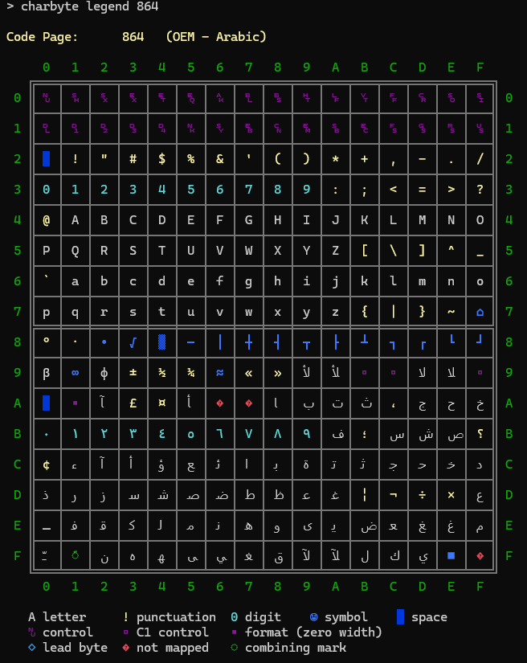

# charbyte



A console table of the 256 byte values of a single-byte code page: what each
byte becomes in Unicode, what kind of character it is, and the bytes that are
not characters at all (controls, format characters, combining marks, lead
bytes, gaps). The grid is the number: the row is the high digit, the column
the low one.

```
Code Page:      1258  (ANSI/OEM - Viet Nam)

     0   1   2   3   4   5   6   7   8   9   A   B   C   D   E   F
   ╔═══╤═══╤═══╤═══╤═══╤═══╤═══╤═══╤═══╤═══╤═══╤═══╤═══╤═══╤═══╤═══╗
 ...
 C ║ À │ Á │ Â │ Ă │ Ä │ Å │ Æ │ Ç │ È │ É │ Ê │ Ë │ ◌̀ │ Í │ Î │ Ï ║ C
 D ║ Đ │ Ñ │ ◌̉ │ Ó │ Ô │ Ơ │ Ö │ × │ Ø │ Ù │ Ú │ Û │ Ü │ Ư │ ◌̃ │ ß ║ D
```

It is an example of the low fixed-base model and the PSDK projection: a
console program, a module object (`wtoi64.asm`), COM (MLang), an enumeration
callback, and static data beside the code that uses it.

## Build

From the repository root:

```bat
examples\_build.cmd charbyte
```

This assembles `charbyte.asm` and `wtoi64.asm` with fasmg and links
`charbyte.exe` from the response file that `charbyte.asm` writes.

## Usage

```
charbyte [help|list] [legend] [locale|codepage] <value>
```

| Argument | Meaning |
|---|---|
| *(none)* | the user locale's OEM code page (437 for en-US) |
| `<number>` | a code page number, e.g. `1252`; `codepage` is the default mode |
| `<name>` | a charset name MLang knows, e.g. `windows-1251` or `koi8-r` |
| `CP_ACP` … `CP_UTF8` | the abstract code page identifiers |
| `locale <name or LCID>` | the ANSI code page of a locale |
| `list` | the installed single-byte code pages |
| `legend` | a key to the cell colors and marks, after the table |
| `help` | the usage text, which also names the default code page |

Arguments are case-insensitive. `legend` may come anywhere, so `charbyte 1255
legend` and `charbyte legend 1255` are the same. A value follows its mode
word: `charbyte locale ru`, not `charbyte ru locale`.

## Choosing a code page

### The default

```bat
charbyte
```

The user locale's OEM code page: the one a console traditionally used. It
comes from the locale (`LOCALE_IDEFAULTCODEPAGE`), not from `CP_OEMCP`. With
Windows' "Use Unicode UTF-8 for worldwide language support" setting,
`CP_OEMCP` is 65001, which has no byte table to show.

### By number

```bat
charbyte 1252
charbyte 850
charbyte codepage 28591
charbyte 037
```

Any installed code page. `charbyte 037` shows EBCDIC: letters in runs
(`a`–`i` at 0x81, `A`–`I` at 0xC1) and digits at 0xF0.

### By name

```bat
charbyte windows-1251
charbyte iso-8859-7
charbyte koi8-u
charbyte ibm866
charbyte macintosh
charbyte x-mac-cyrillic
```

Names are resolved by MLang (`IMultiLanguage2::GetCharsetInfo`), which knows
the Internet charset names and their aliases. An unknown name is an error:

```bat
charbyte no-such-charset
```

```
Unknown code page name.
```

### Abstract identifiers

```bat
charbyte CP_ACP
charbyte CP_OEMCP
charbyte CP_THREAD_ACP
```

These are resolved by the system. With the UTF-8 setting on, `CP_ACP`,
`CP_OEMCP` and `CP_MACCP` are all 65001. `CP_UTF7` and `CP_UTF8` are
accepted, but they are not byte encodings, so a warning precedes the table.

### By locale

```bat
charbyte locale el-GR
charbyte locale ru
charbyte locale 1049
charbyte locale th-TH
```

A locale selects its ANSI code page, and its name is shown above the table:

```
   Locale:      el-GR
Code Page:      1253  (ANSI - Greek)
```

- **Forms:** a full name (`el-GR`), a neutral name (`ru`, resolved to
  `ru-RU`), or a numeric LCID (`1049`).
- **Unicode-only locales have no byte code page:**

  ```bat
  charbyte locale hi-IN
  ```

  ```
  Locale is Unicode-only: no byte code page.
  ```

- **Locales whose ANSI code page is double-byte** still show a table, with
  the lead bytes marked:

  ```bat
  charbyte locale ja-JP
  charbyte locale ko-KR
  ```

### What is installed

```bat
charbyte list
```

```
Installed single-byte code pages:
   10000 (MAC - Roman)
   ...
   1252  (ANSI - Latin I)
   ...
   874   (ANSI/OEM - Thai)
```

Every code page the system can convert in which a character is one byte,
with its name: ANSI, OEM, Mac, ISO 8859, EBCDIC, KOI8, IA5. Any of the
numbers is a valid argument.

## Reading the table

```bat
charbyte legend 1255
```

```
   A letter  0 digit  ! punctuation  ☺ symbol    space
   ␀ control  ▫ C1 control  ▪ format (zero width)
   ◇ lead byte  � not mapped  ◌ combining mark
```

| Cell | Color | Meaning |
|---|---|---|
| `A` | default | a letter |
| `0` | cyan | a digit |
| `!` | yellow | punctuation |
| `☺` | blue | any other symbol |
| ` ` | blue background | a space: the background shows it |
| `␀` … `␟`, `␡` | magenta | a C0 control or DEL, shown as its Unicode Control Picture |
| `▫` | magenta | a C1 control (U+0080–009F); the grid gives the number |
| `▪` | magenta | a format character with no width (LRM, RLM, soft hyphen) |
| `◌̀` | green | a combining mark, shown on a dotted circle |
| `◇` | cyan | a lead byte of a double-byte code page |
| `�` | red | a byte the code page does not map |

The classes come from `GetStringTypeW` on the Unicode character each byte
becomes, so they belong to the code page shown, whatever the locale.

## Tables worth a look

| Command | What it shows |
|---|---|
| `charbyte 437` | the original PC set: 0x01–0x1F as glyphs (☺ ♥ ♪), box drawing, Greek and math |
| `charbyte 1252` | Windows Latin 1, with its five gaps (0x81, 0x8D, 0x8F, 0x90, 0x9D) |
| `charbyte 28591` | ISO 8859-1: 0x80–0x9F are C1 controls, a row of `▫` |
| `charbyte 1255` | Hebrew: vowel points as combining marks through rows C and D, LRM/RLM as `▪` at 0xFD/0xFE |
| `charbyte 1258` | Vietnamese: combining tone marks at 0xCC, 0xD2, 0xDE, 0xEC, 0xF2 |
| `charbyte us-ascii` | 7-bit ASCII: Windows maps the upper half onto the lower (0xC1 is `A`) |
| `charbyte koi8-r` | box drawing in the upper half, then Cyrillic in KOI8's phonetic order |
| `charbyte 037` | EBCDIC: letters in three runs, digits at 0xF0 |
| `charbyte 864` | Arabic OEM |
| `charbyte locale ja-JP` | Shift-JIS (932): lead bytes 0x81–0x9F and 0xE0–0xFC, half-width katakana between |
| `charbyte locale ko-KR` | 949: nearly the whole upper half is lead bytes |

## Errors

Each error is printed in red, followed by the usage text. The exit code is 1
(0 after a table or a list).

| Message | Cause |
|---|---|
| `Invalid code page.` | the number is not an installed code page |
| `Unknown code page name.` | MLang does not know the name |
| `MLang is not available.` | MLang's COM class could not be created |
| `Unable to resolve locale.` | the locale name matches no locale |
| `LCID does not exist for locale.` | the name has no LCID |
| `Invalid locale.` | the LCID is not a locale |
| `Locale is Unicode-only: no byte code page.` | the locale has no ANSI code page (hi-IN) |

Two modes at once (`charbyte locale el-GR codepage 1252`) or a malformed
number (`charbyte 12x`) show the usage text alone. Any other word is taken
as a charset name.

## Notes

- **Console output only.** The table is written with `WriteConsoleW`, so
  redirecting it to a file or a pipe produces nothing.
- **Colors** are ANSI escape sequences. Windows Terminal shows them. In the
  classic console, the shell must have turned on virtual-terminal
  processing, as PowerShell does.
- **Glyphs depend on the font.** Cascadia Mono shows every cell. Some Thai,
  Arabic and Hebrew glyphs, and some combining marks, may need font fallback.
- **Double-byte code pages** are shown byte by byte: a lead byte is only half
  a character, so it is marked rather than converted. The tool is meant for
  single-byte code pages and says so first.
